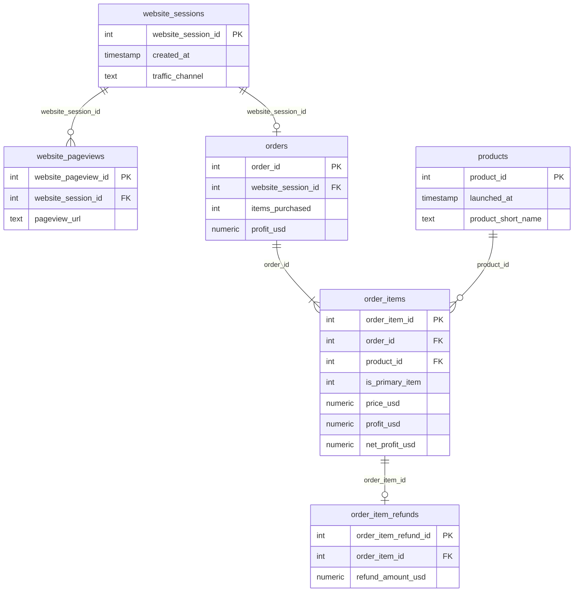
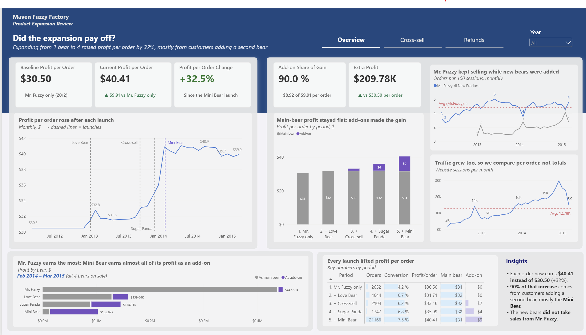
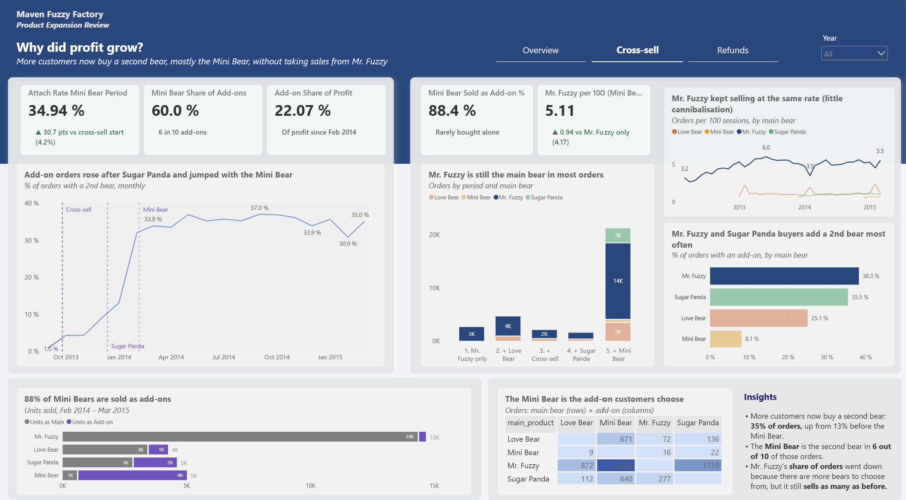
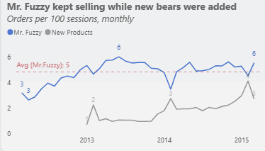
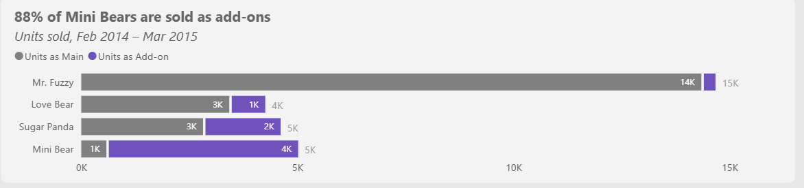
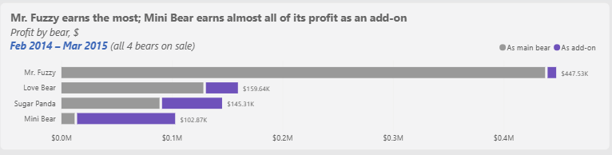
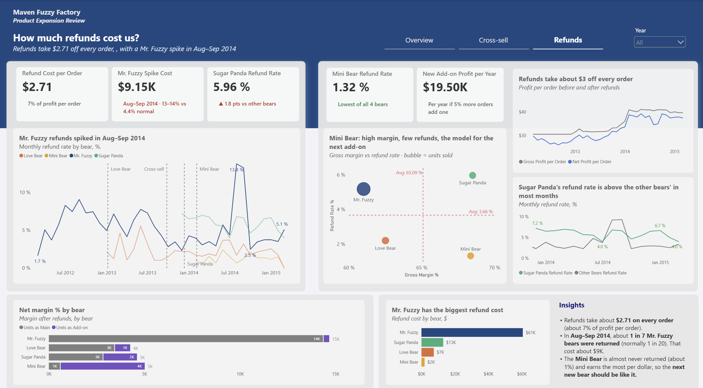

# 🧸 Product Expansion Profitability – Maven Fuzzy Factory (2012–2015)

Analysis of 3 years of website sessions, orders and refunds (470K+ sessions, 32K orders) to find out whether expanding from 1 to 4 products made the business more profitable, using Python, PostgreSQL and Power BI.

# 📑 Table of Contents
- [Project Background](#project-background)
- [Data Structure Overview](#data-structure-overview)
- [Executive Summary](#executive-summary)
- [Insights](#insights)
- [Recommendations](#recommendations)
- [Assumptions and Caveats](#assumptions-and-caveats)

# Project Background

Maven Fuzzy Factory is an online retailer that sells teddy bears through its own website. It launched in March 2012 with one product, **Mr. Fuzzy**, and between 2013 and 2014 added three more: **Love Bear**, **Sugar Panda** and **Mini Bear**. In September 2013 the website also started offering customers a second bear on the cart page (cross-sell).

Adding products costs money and attention, so the CEO and the merchandising team want to know whether it paid off, or whether the new bears only took sales from Mr. Fuzzy. The order data could answer this, but it had never been analysed by launch period. This project analyses **472,871 website sessions and 32,313 orders from March 2012 to March 2015** to answer: *did the product expansion make the business more profitable, and where should the product range go next?*

Insights and recommendations are provided on the following key areas:

- **Launch impact:** how profit per order and conversion changed after each launch
- **Profit drivers & cross-sell:** whether the extra profit came from customers choosing a different first bear or from adding a second bear
- **Cannibalisation:** whether the new bears took sales from Mr. Fuzzy
- **Refunds:** how much refunds cost and which bears are returned most

The Python notebooks used to inspect and clean the data can be found [here](notebooks/).

The SQL views used to prepare the data for analysis and the dashboard can be found [here](sql/00_setup_views.sql).

Targeted SQL queries regarding the business questions can be found [here](sql/).

# Data Structure Overview

The raw data contained **1,735,068 rows** across 6 tables. After cleaning in Python (pandas), the data was loaded into PostgreSQL and summarised in 3 views for the analysis and the Power BI dashboard. No rows were removed during cleaning.

- **website_sessions (472,871 rows):** One row per website visit, with date, traffic source and device.
- **website_pageviews (1,188,124 rows):** One row per page viewed in a session.
- **orders (32,313 rows):** One row per order, with number of items, price and cost.
- **order_items (40,025 rows):** One row per bear sold, with product, price, cost and whether it was the first bear in the order (`is_primary_item`).
- **products (4 rows):** One row per bear, with its launch date.
- **order_item_refunds (1,731 rows):** One row per refunded bear, with the refund amount.

For the analysis, 3 SQL views summarise the tables: `session_summary` (one row per session), `item_summary` (one row per bear sold) and `order_summary` (one row per order). The launch periods and add-on profit are calculated once in these views, so every query and the dashboard use the same logic.

Prior to the analysis, a variety of checks were conducted to understand the data and ensure its quality: no missing values (except UTM and referrer fields in sessions) and no duplicate IDs were found, every order, item and refund links to a real session, order or product, and order totals match their items. Date columns were converted from text to datetime, missing UTM values were labelled as organic/direct search or direct type-in traffic (`traffic_channel`), the incomplete first and last months (Mar 2012, Mar 2015) were flagged, product names were cleaned ("Mini bear" → "Mini Bear"), and profit and net profit after refunds were calculated for every bear sold. The code can be found [here](notebooks/02_data_cleaning.ipynb).

### How to read the dashboard

**The 5 periods.** Orders are grouped into 5 periods. **"+ X"** means *"from the day X launched until the next launch"*, and each period adds something to the one before.

| Period | Dates | What was for sale |
|---|---|---|
| 1. Mr. Fuzzy only | Mar 2012 – 6 Jan 2013 | Mr. Fuzzy |
| 2. + Love Bear | 6 Jan – 25 Sep 2013 | + Love Bear |
| 3. + Cross-sell | 25 Sep – 12 Dec 2013 | + website offers a 2nd bear in the cart |
| 4. + Sugar Panda | 12 Dec 2013 – 5 Feb 2014 | + Sugar Panda |
| 5. + Mini Bear | 5 Feb 2014 – Mar 2015 | + Mini Bear (all 4 bears) |

Cross-sell is **not a new bear**. It is a website change that offers a second bear on the cart page, which is why add-on profit first appears in period 3.

**Main bear vs add-on.**
- **Main bear** = the **first bear** the customer puts in the cart. It can be any of the 4 bears, but most customers pick Mr. Fuzzy.
- **Add-on** = a **second bear** added to the same order.

**Key KPIs.**
- **Profit per order** = (price − product cost) of all bears in the order ÷ number of orders
- **Attach rate** = orders with a second bear ÷ all orders
- **Orders per 100 sessions** = orders ÷ website sessions × 100
- **Refund rate** = refunded bears ÷ bears sold (only orders placed before 3 Mar 2015, so every refund has had time to happen)

# Executive Summary

### Overview of Findings

Since all 4 bears went on sale, each order earns **$40.41 instead of $30.50 (+32%)**, which added about **$210K** of profit over 13 months. Four main findings stand out:

- **Launch impact:** Profit per order rose in **every period**, and the biggest jump came with the Mini Bear launch in Feb 2014.
- **Profit drivers & cross-sell:** **90%** of the gain came from customers adding a second bear, mostly the Mini Bear, not from customers choosing a more expensive first bear.
- **Cannibalisation:** The new bears did **not** take sales from Mr. Fuzzy. Mr. Fuzzy orders per 100 sessions rose from **about 3** in 2012 to **5–6** after the new bears launched.
- **Refunds:** Refunds take **$2.71** off every order. Sugar Panda is returned most often, and a Mr. Fuzzy spike in Aug–Sep 2014 cost about **$9K**.

The following sections explore each of these areas in detail and highlight opportunities for improvement.

Below is the overview page from the Power BI dashboard, and more examples are included throughout the report.

# Insights

### Launch impact

- **Profit per order rose in every period.** It grew from **$30.50** (Mr. Fuzzy only) to $31.71, $33.16, $35.99 and finally **$40.41** after the Mini Bear launch. Prices never changed, so the gain comes from *what* customers buy, not from higher prices.
- **More visitors buy something.** Conversion rose from **4.2%** to **7.5%** of sessions. It dipped only once, from 6.7% to 6.2% in the cross-sell period.
- **Traffic grew a lot, so totals would be misleading.** Monthly sessions grew from a few thousand in 2012 to over 20K in early 2015, so total profit would rise even without new bears. That is why this analysis compares **per order** and **per 100 sessions**.
- **The expansion added about $210K of profit.** In the Mini Bear period, 21,166 orders earned **$40.41** each instead of $30.50. That is **$209,780 more profit** than if nothing had changed, and **$188,805 (90%)** of it came from customers buying a second bear.

### Profit drivers & cross-sell

- **The first bear earns the same; the second bear made the gain.** Profit from the main bear stayed at about **$31** in every period. Profit from add-ons grew from **$0 to $8.92** per order, which is about **90%** of the $9.91 gain.
- **Cross-selling grew with Sugar Panda and took off with the Mini Bear.** The share of orders with a second bear rose from **4.2%** when cross-sell started to 13.1% with Sugar Panda and **34.9%** with the Mini Bear (about 1 in 3 orders).
- **The Mini Bear is the add-on customers choose.** It is the second bear in **6 out of 10** two-bear orders, and **88%** of all Mini Bears are sold as an add-on. Of its $102.9K profit in the Mini Bear period, $91.0K came from add-on sales.
- **Add-ons are now a real part of the business.** Since Feb 2014, **22%** of all profit comes from second bears. Mr. Fuzzy and Sugar Panda buyers add a second bear most often (**38%** and **36%** of their orders since cross-sell started), Love Bear buyers less often (25%).

### Cannibalisation

- **Mr. Fuzzy kept selling.** Out of every 100 website sessions, about **3** ordered a Mr. Fuzzy in 2012. After the new bears launched, this stayed at about **5–6**, with an average of about **5**. If the new bears had taken Mr. Fuzzy's sales, this line would have dropped. Instead, the new bears added **1–4 extra orders per 100 sessions** on top. This suggests they brought extra sales instead of replacing Mr. Fuzzy.

    

- **Mr. Fuzzy lost share, not sales.** Mr. Fuzzy is still the main bear in about **2 out of 3** orders (about 14K of 21K orders in the Mini Bear period). The share went down only because customers now have more bears to choose from.

    

- **Mr. Fuzzy is still the biggest earner.** Mr. Fuzzy made **$447.5K** profit in the Mini Bear period, almost all as the main bear, compared with $159.6K for Love Bear, $145.3K for Sugar Panda and $102.9K for Mini Bear.

    

### Refunds

- **Refunds take $2.71 off every order.** In the Mini Bear period, profit per order drops from **$40.44 to $37.73** after refunds (about 7%).
- **Sugar Panda is returned most often; the Mini Bear almost never.** Refund rates are **6.0%** for Sugar Panda, 5.2% for Mr. Fuzzy, 2.2% for Love Bear and **1.3%** for Mini Bear. Sugar Panda's refund rate is above the other bears' in most months.
- **Mr. Fuzzy refunds spiked in Aug–Sep 2014.** About **1 in 7** Mr. Fuzzy bears were returned (13.8% and 13.3%), compared with fewer than 1 in 20 (4.4%) in other months. The extra refunds cost about **$9.1K**. The data does not record why bears were returned, so the cause of this jump is unknown.
- **The Mini Bear keeps the most profit after refunds.** Net margin (profit after refunds ÷ sales) is **67.0%** for Mini Bear, 62.5% for Sugar Panda, 60.3% for Love Bear and 55.8% for Mr. Fuzzy.

# Recommendations

Based on the uncovered insights, the following recommendations are provided for the CEO and the merchandising team:

- The Mini Bear is sold as an add-on **88%** of the time, has the lowest refund rate (**1.3%**) and the highest net margin (**67%**). **Launch another low-priced, high-margin bear designed to be bought as a second bear.** If 5% more orders added it, it would earn about **$19.5K more profit per year**.
- Mr. Fuzzy sales held steady (about **5** orders per 100 sessions) while 3 bears were added. **Keep expanding the range, and keep Mr. Fuzzy as the main product.**
- Love Bear buyers add a second bear less often (**25%**) than Mr. Fuzzy buyers (**38%**). **Test a better add-on offer for Love Bear buyers**, for example a matching gift bear.
- Mr. Fuzzy refunds jumped to about **1 in 7** in Aug–Sep 2014, costing about **$9K**. **Find out what caused the jump in that period, and set up a monthly alert when a bear's refund rate goes above 10%.**
- Sugar Panda has the highest refund rate (**6.0%**) in most months. **Find out why Sugar Panda is returned more often, for example by reviewing customer feedback.**
- Website tests ran during the same period as the launches. **Run the next product launch as an A/B test** to measure its real effect.

# Assumptions

Throughout the analysis, several assumptions were made to manage challenges with the data:

- **Results are associated with the launches, not proven causes.** Website tests (new landing pages and a new billing page) ran at the same time as the launches. These mainly affect conversion, so the profit-per-order findings are less affected.
- **Refund rates only use orders placed before 3 Mar 2015.** Refunds happen 2–16 days after an order, so the last weeks of data may still have refunds to come.
- **Mar 2012 and Mar 2015 are incomplete months.** They are flagged and left out of monthly trends.
- **The periods have different lengths and seasons.** The Sugar Panda period is only 8 weeks and includes Christmas and Valentine's Day, while the Mini Bear period covers 13 months. Periods are compared per order, not by totals.
- **Refund reasons are not in the data.** The analysis shows which bears are returned and when, but not why.
- **Profit = price − product cost.** Shipping, marketing and other costs are not in the data.
- **The dollar estimates are scenarios.** The $19.5K new add-on estimate assumes order volume stays at the level of the last 12 full months (Mar 2014 – Feb 2015) and $20.50 profit per add-on, like the Mini Bear. The $9.1K spike cost assumes a normal Mr. Fuzzy refund rate of 4.4%.
- **The data is a sample dataset.** Maven Fuzzy Factory is a fictional company from a Maven Analytics practice dataset.
